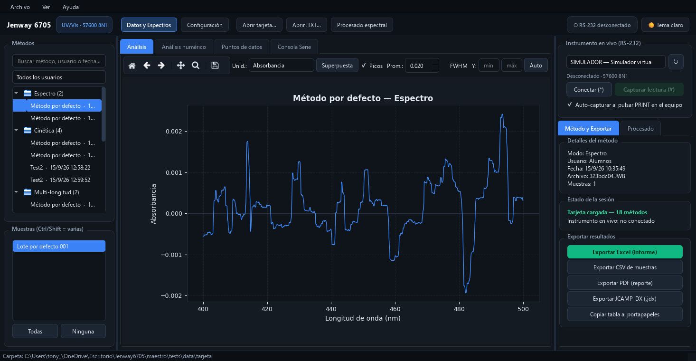

# Programa Maestro — Jenway 6705

Aplicación de escritorio que reemplaza al **67-Series Software Suite (DataWay)** del
espectrofotómetro Jenway 6705: lee sus formatos nativos, replica los cálculos de los
5 modos de medición y exporta informes — sin depender del software original.



## Qué hace

- **Lee la tarjeta copiada del instrumento**: `.JWB` (datos binarios), `.JWX` (índice),
  `.JWU` (usuarios) y los reportes impresos `.TXT` (fonética CP1252/Latin-1).
- **Replica los 5 modos** validando contra el reporte impreso del propio equipo:
  photometrics, spectrum, multi-longitud, kinetics y quantitation (interpolación por
  segmentos, igual que el instrumento).
- **Procesado espectral no destructivo** (con deshacer): suavizado Savitzky-Golay,
  línea base SNIP, derivadas, normalizaciones, recorte y aritmética entre espectros.
- **Exporta**: Excel (`informe.xlsx` con hoja Resumen + figuras incrustadas), CSV,
  figuras PNG/SVG, PDF.
- **Interfaz PySide6** en español: árbol de métodos por usuario/modo, gráficos con
  zoom, tema oscuro/claro, conexión RS-232 con el equipo real (banco de pruebas
  incluido).

## Validación

Los decodificadores están validados contra reportes impresos reales del instrumento
(`decode(JWB) ≡ reporte .TXT`). La suite dorada:

```bash
py -3 -m pytest tests -q --tb=no   # 441 passed / 0 fail
```

Datos dorados en `tests/data/` (tarjeta completa, `.JWB` por modo, reportes `.TXT`).

## Arranque rápido (desarrollo)

```bash
pip install PySide6 matplotlib numpy openpyxl pyserial   # + scipy, pytest para tests
py -3 Script/leer_carpeta.py  <carpeta_tarjeta>  listar  # ver métodos
py -3 Script/leer_carpeta.py  <carpeta_tarjeta>  ver     # decodificar todos los .JWB
py -3 Script/analizar.py      <carpeta_tarjeta>  <salida>    # informe Excel + figuras
py -3 Script/maestro_gui.py   <carpeta_tarjeta>           # o doble clic en Maestro.bat
```

## Versión portable (sin Python)

El empaquetado PyInstaller genera una carpeta con dos ejecutables:

- `Programa_Maestro.exe` — la aplicación de escritorio.
- `Escanear_Serie.exe` — banco de pruebas RS-232 (diagnóstico de conexión con el equipo).

Reconstrucción: `py -3 -m PyInstaller --clean --noconfirm maestro_portable.spec`
(requiere PyInstaller; excluye scipy/pytest/WebEngine para recortar el tamaño).

## Estructura

```
jenway67/    núcleo: parsers (.JWB/.JWX/.JWU/.TXT), modelos, análisis, informe
ui/          interfaz PySide6 (ventana, gráficos, procesado, conexión)
Script/      CLIs: leer_carpeta, analizar, leer_jwb, leer_reporte, escanear_serie
tests/       suite dorada + muestras versionadas (pytest, nodeps: externas)
docs/        especificación del formato de archivos y documentación
```

Documentación técnica: `docs/Especificacion_Formato_Jenway_6705.md` (formatos de
archivo validados) y `maestro/Escanear_Serie.md` (protocolo RS-232 verificado).

## Notas del instrumento

- La absorbancia **satura en 3.000** (el equipo la recorta; aquí se clampa igual en
  pantalla y exportaciones).
- El `.JWB` guarda %Transmitancia a 0.1 nm (resolución nativa); el reporte impreso
  va a 1.0 nm. El programa lee ambos.
- Firmware del equipo usado para validar: `67xx V1.64.5`.

## Licencia

Sin licencia pública: código propiedad del autor. Se publica para su consulta; no se
otorgan derechos de reutilización. (Añadir MIT/GPL aquí si se decide liberar.)
