# Plan de Implementación — Programa Maestro 6705 → Nivel Profesional

> Análisis de brechas entre el estado actual del proyecto y un software de espectroscopía
> competente (referencia: Spectragryph), con plan de mejoras priorizado por impacto y viabilidad.

---

## Diagnóstico: ¿Dónde estamos?

### Lo que ya funciona bien ✅
- Decodificación de los 5 modos (.JWB) validada punto a punto
- Parseo del índice (.JWX), usuarios (.JWU) y reportes (.TXT)
- GUI en PySide6 con temas oscuro/claro bien integrados con Matplotlib
- Navegación jerárquica: Métodos → Muestras
- Exportación batch a Excel (con gráficos incrustados) y CSV
- Análisis básico: picos, derivadas, AUC, cinética (rate), calibración (lineal/cuadrática)

### Brechas críticas vs. software competente 🔴

| Área | Estado actual | Spectragryph / estándar profesional |
|---|---|---|
| **Interacción con gráficos** | Plot estático, sin zoom/pan/cursor | Zoom rectangular, pan, cursor multi-espectro, historial de zoom |
| **Superposición de espectros** | Solo 1 espectro a la vez | Overlay de cientos, stacked view, comparación |
| **Procesamiento espectral** | Derivadas y picos básicos | Baseline, smoothing, normalización, sustracción, recorte |
| **Detección de picos** | Hardcoded (prominencia=0.2, max 8) | Configurable, con FWHM, tabla exportable |
| **Cambio de unidades** | Solo Abs (derivada de %T) | Toggle %T ↔ Abs en la GUI |
| **Organización de datos** | Lista plana de métodos | Agrupación por modo, filtrado, búsqueda |
| **Operaciones entre espectros** | No existe | Suma, resta, división, ratio |
| **Exportación PDF** | Botón deshabilitado | PDF con plots y metadata |
| **Copiar al portapapeles** | No existe | Plot como imagen, datos como texto |
| **Tabla de datos** | QTableWidget con cap 1500 filas | Tabla virtual sin límite |
| **Drag & drop** | No existe | Arrastrar archivos/carpetas |

### Bugs conocidos que corregir 🐛
1. **Bug en gráfico de Cuantificación** ([informe.py](file:///C:/Users/tony_/OneDrive/Escritorio/Jenway6705/maestro/jenway67/informe.py) ~línea 95): `conc_muestra` recibe `abs_muestra` en vez de la concentración interpolada → la muestra se ubica en $(A, A)$ en vez de $(A, C)$.
2. **Multi-λ sin gráfico en export** ([informe.py](file:///C:/Users/tony_/OneDrive/Escritorio/Jenway6705/maestro/jenway67/informe.py) ~línea 102): devuelve `None` para modo `multi`.
3. **Directorio de salida** escrito como `"Xslx"` en vez de `"Xlsx"`.
4. **Análisis solo de la primera muestra**: para spectrum/kinetics/quantitation, las métricas se calculan solo sobre `rs[0]`, ignorando muestras subsiguientes.
5. **XML parseado con regex**: vulnerable a cambios de formato del fabricante.

---

## Propuesta de Fases

> [!IMPORTANT]
> Las fases están ordenadas por **impacto percibido por el usuario**. La Fase 0 y 1 son las que más transforman la experiencia. Cada fase es un incremento funcional completo y entregable.

---

### Fase 0 — Corrección de Bugs y Quick Wins ⚡
**Esfuerzo estimado: 1–2 sesiones**

#### [MODIFY] [informe.py](file:///C:/Users/tony_/OneDrive/Escritorio/Jenway6705/maestro/jenway67/informe.py)
- Corregir `conc_muestra` en gráfico de cuantificación (pasar concentración interpolada, no absorbancia).
- Agregar gráfico de barras para modo Multi-λ (reutilizar lógica de `ventana.py`).
- Renombrar directorio `"Xslx"` → `"Excel"`.
- Calcular métricas analíticas sobre **todas** las muestras del método, no solo `rs[0]`.

#### [MODIFY] [parser_jwx.py](file:///C:/Users/tony_/OneDrive/Escritorio/Jenway6705/maestro/jenway67/parser_jwx.py) / [parser_jwu.py](file:///C:/Users/tony_/OneDrive/Escritorio/Jenway6705/maestro/jenway67/parser_jwu.py)
- Migrar de regex a `xml.etree.ElementTree` para robustez.

#### [MODIFY] [ventana.py](file:///C:/Users/tony_/OneDrive/Escritorio/Jenway6705/maestro/ui/ventana.py)
- Conectar `combo_formato` (CSV/Excel/PDF) a las acciones de exportación correspondientes, o eliminarlo si es redundante.
- Habilitar el botón PDF como placeholder con mensaje "próximamente".

---

### Fase 1 — Visualización Interactiva 📊
**Esfuerzo estimado: 3–4 sesiones** · **Impacto: MÁXIMO**

> Esta es la fase que más transforma la percepción de "software profesional".

#### [MODIFY] [ventana.py](file:///C:/Users/tony_/OneDrive/Escritorio/Jenway6705/maestro/ui/ventana.py)

**1.1 Barra de herramientas de Matplotlib (`NavigationToolbar2QT`)**
- Agregar toolbar debajo del canvas con: Zoom rectangular, Pan, Home (reset), Guardar imagen.
- Personalizar iconos y tooltips al español.

**1.2 Cursor interactivo con lectura de coordenadas**
- Implementar crosshair que siga el mouse sobre el canvas.
- Mostrar coordenadas `(λ, Abs)` o `(t, Abs)` en la barra de estado en tiempo real.
- Para overlay: mostrar valores de **todos** los espectros superpuestos al cursor (multi-cursor al estilo Spectragryph).

**1.3 Superposición de múltiples espectros (Overlay)**
- Cambiar `lista_muestras` de selección simple a **selección múltiple** (`QListWidget.ExtendedSelection`).
- Al seleccionar varias muestras del mismo modo, dibujar todas superpuestas con colores distintos (paleta automática) y leyenda.
- Botón "Seleccionar todas" / "Deseleccionar todas".

**1.4 Toggle de unidades: %T ↔ Absorbancia**
- Agregar un `QComboBox` o botón toggle junto al canvas: `[Absorbancia ▾]` / `[%Transmitancia]`.
- Re-dibujar el gráfico en las unidades seleccionadas.

**1.5 Vista apilada (Stacked View)**
- Botón para alternar entre overlay (superpuesto) y stacked (desplazamiento vertical progresivo).
- Útil para comparar formas de banda sin confusión de escalas.

#### [NEW] [ui/toolbar_plot.py](file:///C:/Users/tony_/OneDrive/Escritorio/Jenway6705/maestro/ui/toolbar_plot.py)
- Widget reutilizable que encapsule: Canvas + Toolbar + controles de unidad/vista + barra de coordenadas.

---

### Fase 2 — Organización y Gestión de Datos 🗂️
**Esfuerzo estimado: 2–3 sesiones** · **Impacto: ALTO**

#### [MODIFY] [ventana.py](file:///C:/Users/tony_/OneDrive/Escritorio/Jenway6705/maestro/ui/ventana.py)

**2.1 Agrupación por modo de ensayo**
- Reemplazar la lista plana de métodos por un **`QTreeWidget`** con niveles:
  ```
  📁 Espectro (3)
  │   ├── Esp-Agua  ·  15/9/26 10:30
  │   └── Esp-Azul  ·  15/9/26 11:15
  📁 Cinética (4)
  │   ├── Test2-Run1  ·  15/9/26 12:00
  │   └── ...
  📁 Cuantificación (2)
  📁 Fotometría (1)
  📁 Multi-longitud (2)
  ```
- Expandir/colapsar por modo. Badge con conteo de métodos.

**2.2 Filtro y búsqueda**
- Campo de búsqueda (`QLineEdit` con ícono 🔍) encima del árbol de métodos.
- Filtro en tiempo real por nombre de método, usuario o fecha.

**2.3 Filtro por usuario**
- `QComboBox` con los usuarios del `.JWU`: `[Todos ▾]`, `Alumnos`, `Supervisor`, etc.
- Al seleccionar, ocultar los métodos de otros usuarios.

**2.4 Drag & Drop**
- Aceptar `dragEnterEvent` / `dropEvent` para carpetas y archivos `.JWB`/`.TXT` arrastrados a la ventana.
- Implementar `QMainWindow.setAcceptDrops(True)`.

**2.5 Apertura de archivos individuales**
- En el menú Archivo: "Abrir archivo .JWB…" y "Abrir reporte .TXT…" con `QFileDialog.getOpenFileName`.
- Decodificar sin necesidad de un `.JWX` (usar heurística de modo).

#### [MODIFY] [ventana.py](file:///C:/Users/tony_/OneDrive/Escritorio/Jenway6705/maestro/ui/ventana.py) — Tabla de datos

**2.6 Tabla virtualizada (QAbstractTableModel)**
- Reemplazar `QTableWidget` por un `QTableView` + `QAbstractTableModel` personalizado.
- Elimina el cap de 1,500 filas; rendimiento fluido con 40,000+ puntos de espectro.
- Columnas ordenables por click en cabecera.

---

### Fase 3 — Procesamiento Espectral 🔬
**Esfuerzo estimado: 3–4 sesiones** · **Impacto: ALTO**

> Estas son las herramientas que un científico espera al procesar datos espectrales.

#### [NEW] [jenway67/procesamiento.py](file:///C:/Users/tony_/OneDrive/Escritorio/Jenway6705/maestro/jenway67/procesamiento.py)
Módulo de procesamiento espectral con funciones puras (entrada: arrays numpy, salida: arrays numpy):

**3.1 Suavizado (Smoothing)**
- Savitzky-Golay configurable: grado del polinomio (2–5) y ventana (5–51 puntos).
- Preview en tiempo real con slider.

**3.2 Corrección de línea base (Baseline)**
- Sustracción lineal (2 puntos).
- Sustracción polinómica (orden 1–5).
- Baseline adaptativa (percentil + media móvil) para fluorescencia/dispersión.

**3.3 Normalización**
- Al pico máximo (=1.0).
- Al área (integral =1.0).
- A un valor de referencia en λ específica.
- SNV (Standard Normal Variate): $(x - \bar{x}) / \sigma$.

**3.4 Recorte espectral (Crop/Trim)**
- Seleccionar rango $[\lambda_a, \lambda_b]$ interactivamente en el gráfico (click-drag).
- Descartar puntos fuera del rango.

**3.5 Operaciones matemáticas entre espectros**
- Resta: $S_1 - S_2$ (sustracción de blanco/solvente).
- División: $S_1 / S_2$ (espectro de ratio).
- Suma y multiplicación por escalar.
- Interfaz: seleccionar 2 espectros → elegir operación → resultado como nuevo espectro virtual.

#### [NEW] [ui/panel_procesamiento.py](file:///C:/Users/tony_/OneDrive/Escritorio/Jenway6705/maestro/ui/panel_procesamiento.py)
- Panel lateral o diálogo con controles (sliders, spinboxes) para cada operación de procesamiento.
- Preview en vivo sobre el gráfico (línea punteada = original, línea sólida = procesado).
- Botones "Aplicar" / "Cancelar" / "Deshacer".

#### [MODIFY] [analisis.py](file:///C:/Users/tony_/OneDrive/Escritorio/Jenway6705/maestro/jenway67/analisis.py)

**3.6 Detección de picos mejorada**
- Parámetros configurables desde la GUI: prominencia, distancia mínima, umbral de ruido, número máximo de picos.
- Calcular FWHM (Full Width at Half Maximum) para cada pico.
- Tabla de picos exportable: λ, Abs, FWHM, prominencia, tipo (max/min).

**3.7 Integración interactiva de bandas**
- Seleccionar región de integración visualmente en el gráfico.
- Modo: sobre línea base cero o sobre línea base linear entre extremos.
- Mostrar área sombreada en el gráfico.

---

### Fase 4 — Exportación y Reportes Profesionales 📄
**Esfuerzo estimado: 2–3 sesiones** · **Impacto: MEDIO-ALTO**

#### [NEW] [jenway67/exportar_pdf.py](file:///C:/Users/tony_/OneDrive/Escritorio/Jenway6705/maestro/jenway67/exportar_pdf.py)

**4.1 Exportación a PDF**
- Usar `reportlab` o `matplotlib.backends.backend_pdf.PdfPages`.
- Contenido del PDF por método:
  - Encabezado: nombre del método, modo, usuario, fecha, instrumento.
  - Gráfico vectorial del espectro/cinética/calibración.
  - Tabla de datos numéricos (resumen, no los 7000 puntos).
  - Tabla de picos detectados.
  - Métricas analíticas (AUC, pendiente, $R^2$, etc.).
- Opción de PDF consolidado (todos los métodos) o individual.

#### [MODIFY] [ventana.py](file:///C:/Users/tony_/OneDrive/Escritorio/Jenway6705/maestro/ui/ventana.py)

**4.2 Copiar al portapapeles**
- `Ctrl+C` sobre el gráfico → copia imagen PNG al portapapeles (vía `QApplication.clipboard().setPixmap()`).
- `Ctrl+Shift+C` sobre la tabla → copia datos tabulares como texto separado por tabs (pegable en Excel).

**4.3 Guardar gráfico individual**
- Click derecho en el canvas → menú contextual: "Guardar como PNG…", "Guardar como SVG…", "Copiar imagen".

**4.4 Exportación JCAMP-DX**
- Formato universal de intercambio espectral (`.dx` / `.jdx`).
- Permite abrir los datos en cualquier otro software de espectroscopía (Spectragryph, OMNIC, etc.).

#### [MODIFY] [exportar.py](file:///C:/Users/tony_/OneDrive/Escritorio/Jenway6705/maestro/jenway67/exportar.py)

**4.5 Exportación CSV mejorada**
- Opción de exportar la vista actual (con procesamiento aplicado) además del dato crudo.
- Incluir metadatos como comentarios (`#`) al inicio del CSV.

---

### Fase 5 — Pulido de UX y Features Avanzados ✨
**Esfuerzo estimado: 3–4 sesiones** · **Impacto: MEDIO**

#### [MODIFY] [ventana.py](file:///C:/Users/tony_/OneDrive/Escritorio/Jenway6705/maestro/ui/ventana.py)

**5.1 Panel de propiedades del espectro**
- Al seleccionar una muestra, panel lateral con:
  - Nombre, modo, usuario, fecha, archivo `.JWB`.
  - Rango λ, número de puntos, intervalo.
  - Color de línea (editable con `QColorDialog`).

**5.2 Anotaciones en el gráfico**
- Click derecho → "Agregar anotación" → texto libre posicionado en $(λ, Abs)$.
- Arrastrable, eliminable. Útil para marcar bandas de interés.

**5.3 Atajos de teclado completos**
| Atajo | Acción |
|---|---|
| `Ctrl+O` | Abrir tarjeta |
| `Ctrl+Shift+O` | Abrir archivo individual |
| `Ctrl+E` | Exportar Excel |
| `Ctrl+Shift+E` | Exportar CSV |
| `Ctrl+P` | Exportar PDF |
| `Ctrl+C` | Copiar gráfico |
| `Ctrl+Shift+C` | Copiar datos |
| `Ctrl+A` | Seleccionar todas las muestras |
| `Ctrl+T` | Toggle %T / Abs |
| `F5` | Refrescar |
| `F11` | Pantalla completa |

**5.4 Historial de procesamiento (Undo/Redo)**
- Pila de operaciones aplicadas a cada espectro.
- `Ctrl+Z` / `Ctrl+Y` para deshacer/rehacer transformaciones.

**5.5 Barra de estado enriquecida**
- Mostrar: ruta de la tarjeta | N métodos cargados | modo actual | coordenadas del cursor | indicador de procesamiento aplicado.

#### [NEW] [ui/dialogo_picos.py](file:///C:/Users/tony_/OneDrive/Escritorio/Jenway6705/maestro/ui/dialogo_picos.py)
- Diálogo modal con la tabla completa de picos detectados.
- Sliders para ajustar prominencia y distancia en tiempo real.
- Botón "Exportar tabla de picos" (CSV/clipboard).

---

### Fase 6 — Futuro / Extensiones Avanzadas 🚀
**Sin prioridad inmediata — evaluar según demanda**

| Feature | Descripción | Complejidad |
|---|---|---|
| **Conexión serial en vivo** | Comunicación RS232/FTDI con el Jenway 6705 para adquisición en tiempo real | Alta |
| **Comparación con librerías espectrales** | Importar librerías de referencia y calcular similitud (HQI) | Alta |
| **Pipeline automatizado** | Cadena de procesamiento reutilizable: baseline → smooth → peaks → export | Media |
| **Vista "espectroscopio"** | Simulación visual del espectro visible como barra de color (al estilo Spectragryph F5) | Baja |
| **Importar SPC/JCAMP-DX** | Leer formatos de otros instrumentos para comparación cruzada | Media |
| **i18n (inglés)** | Internacionalización de la interfaz (labels, menús, reportes) | Media |
| **Firma digital de reportes** | Hash SHA-256 del dato crudo incluido en el PDF para trazabilidad | Baja |
| **Modo oscuro del PDF** | Generar PDFs con esquema de colores oscuro para presentaciones | Baja |

---

## Arquitectura de archivos propuesta (post-implementación)

```
maestro/
├── jenway67/                    # Backend (sin dependencia de GUI)
│   ├── __init__.py
│   ├── models.py                # Dataclasses: Tarjeta, Metodo, Muestra, Usuario
│   ├── parser_jwb.py            # Decodificador binario .JWB
│   ├── parser_jwx.py            # Parser XML .JWX (migrado a ElementTree)
│   ├── parser_jwu.py            # Parser XML .JWU (migrado a ElementTree)
│   ├── parser_txt.py            # Parser de reportes .TXT
│   ├── reader.py                # Lector de tarjeta (orquestador)
│   ├── analisis.py              # Análisis: picos(+FWHM), derivadas, AUC, cinética, calibración
│   ├── procesamiento.py         # [NEW] Smoothing, baseline, normalización, crop, math
│   ├── graficos.py              # Generador de gráficos (batch, backend Agg)
│   ├── exportar.py              # Exportación CSV (mejorada)
│   ├── exportar_pdf.py          # [NEW] Exportación PDF
│   ├── exportar_jcamp.py        # [NEW] Exportación JCAMP-DX
│   ├── excel.py                 # Exportación Excel
│   ├── informe.py               # Orquestador de informes (bugs corregidos)
│   └── utilidades.py            # Utilidades comunes
│
├── ui/                          # Frontend PySide6
│   ├── __init__.py
│   ├── app.py                   # Entry point
│   ├── estilos.py               # Temas QSS + colores Matplotlib
│   ├── ventana.py               # Ventana principal (refactorizada)
│   ├── toolbar_plot.py          # [NEW] Widget Canvas+Toolbar+Cursor+Controles
│   ├── panel_procesamiento.py   # [NEW] Panel de procesamiento espectral
│   ├── dialogo_picos.py         # [NEW] Diálogo de tabla de picos configurable
│   └── modelo_tabla.py          # [NEW] QAbstractTableModel para tabla virtualizada
│
└── tests/
    ├── data/                    # Archivos de prueba versionados
    ├── test_parser_jwb.py
    ├── test_parser_txt.py
    ├── test_fase1.py
    ├── test_fase2.py
    ├── test_procesamiento.py    # [NEW] Tests del módulo de procesamiento
    └── smoke_gui.py
```

---

## Orden de ejecución recomendado

```mermaid
gantt
    title Roadmap — Programa Maestro 6705
    dateFormat X
    axisFormat %s
    
    section Fase 0 · Bugs
    Corregir bugs conocidos           :f0, 0, 2
    Migrar XML a ElementTree          :f0b, 0, 2
    
    section Fase 1 · Visualización
    Toolbar Matplotlib                :f1a, 2, 3
    Cursor interactivo                :f1b, 3, 4
    Overlay multi-espectro            :f1c, 4, 6
    Toggle %T / Abs                   :f1d, 4, 5
    Vista apilada                     :f1e, 5, 6

    section Fase 2 · Datos
    TreeWidget por modo               :f2a, 6, 7
    Filtro y búsqueda                 :f2b, 7, 8
    Drag and drop                     :f2c, 7, 8
    Tabla virtualizada                :f2d, 8, 9

    section Fase 3 · Procesamiento
    Smoothing Savitzky-Golay          :f3a, 9, 10
    Baseline correction               :f3b, 10, 11
    Normalización                     :f3c, 11, 12
    Math entre espectros              :f3d, 12, 13
    Picos mejorados + FWHM           :f3e, 9, 10

    section Fase 4 · Exportación
    PDF profesional                   :f4a, 13, 14
    Clipboard (imagen + datos)        :f4b, 13, 14
    JCAMP-DX                         :f4c, 14, 15

    section Fase 5 · UX
    Atajos de teclado                 :f5a, 15, 16
    Anotaciones                       :f5b, 15, 16
    Undo/Redo                        :f5c, 16, 17
```



---

## Open Questions

> [!IMPORTANT]
> **¿Cuáles fases quieres priorizar?**  
> El plan cubre 6 fases. Puedo empezar por la Fase 0+1 (bugs + visualización interactiva) que es donde más impacto se percibe, o si prefieres otro orden, dime.

> [!IMPORTANT]
> **¿Tienes preferencia de librería para PDFs?**  
> Opciones: `reportlab` (muy completo, control total) vs. `matplotlib.backends.backend_pdf` (más simple, solo gráficos) vs. `weasyprint` (HTML→PDF, buen diseño). Recomiendo `reportlab` para informes profesionales.

> [!IMPORTANT]  
> **¿Quieres mantener compatibilidad con los exports actuales?**  
> Al corregir el directorio `"Xslx"` → `"Excel"` y mejorar CSVs, usuarios con scripts que dependan de la estructura actual podrían verse afectados. ¿Es esto un problema?

> [!NOTE]
> **Sobre features de Spectragryph que NO se incluyen intencionalmente:**
> - Soporte de 89+ formatos de archivo (solo necesitamos JWB/JWX/JWU/TXT + JCAMP-DX para intercambio)
> - Adquisición de hardware multi-fabricante (solo Jenway 6705 vía serial, y como Fase 6)
> - Deconvolución Gaussiana avanzada / MLR / thin-film (fuera del alcance del instrumento)
> - EEM / Raman-específico (el Jenway 6705 es UV-Vis)
>
> El enfoque es hacer un **software excelente para el Jenway 6705**, no un clon genérico de Spectragryph.

## Verification Plan

### Automated Tests
- Extender `test_parser_jwb.py` y `test_parser_txt.py` con los bugs corregidos.
- Nuevo `test_procesamiento.py` con golden tests para smoothing, baseline, normalización.
- `smoke_gui.py` ampliado para validar nuevos widgets (toolbar, overlay, tree).

### Manual Verification
- Comparar visualmente gráficos overlay con los reportes originales del instrumento.
- Verificar exports PDF/JCAMP abriendo en Spectragryph u otro visor.
- Pruebas de rendimiento con espectros de 7,000+ puntos en tabla virtualizada.
